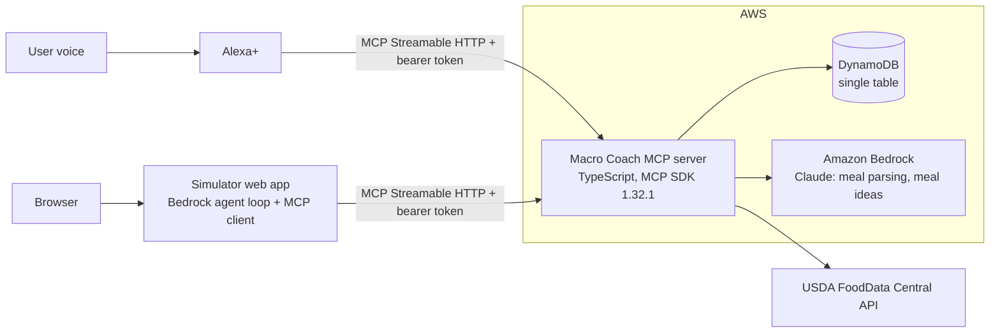

# Macro Coach

A voice-first nutrition coach for Alexa+. Tell Alexa what you ate; Macro Coach logs it, computes calories and macros from USDA FoodData Central, tracks you against your daily targets and suggests what to eat next.

> This project is new and was built during the Build, Ship, Shape: Amazon Developer Hackathon window (October 2026).

## 30-second pitch

Tracking food is the most effective habit for body composition goals, and the most abandoned, because typing every meal into an app is tedious. Macro Coach removes the typing. You say "I had two scrambled eggs and a banana for breakfast" and it's logged with real USDA numbers. Ask "how much protein do I still need?" or "what should I eat for dinner? I have chicken, rice and broccoli" and you get a short, spoken answer grounded in data, never invented numbers.

## Architecture



## MCP surface

| Tool | What it does |
|---|---|
| `log_meal` | Parses a free-text meal, resolves each item against FDC, stores entries, returns macros and the remaining budget. Asks a question instead of guessing when a portion is ambiguous. |
| `edit_log_entry` | "Make that one egg, not two" or "remove the banana". Defaults to the latest matching entry. |
| `get_daily_summary` | Calories, protein, carbs, fat and fiber versus targets for a day. |
| `get_remaining_budget` | What's left today plus a one-line coaching hint. |
| `suggest_meal` | 1 to 3 meal ideas from remaining macros, available ingredients and constraints; macros computed from FDC. |
| `set_goals` | Direct targets, or computed from a profile with Mifflin-St Jeor for cut, maintain or bulk. |
| `get_weekly_report` | 7-day averages, adherence, best and worst day, one tip. |
| `search_food` | Nutrition facts for one food without logging it. |

Also: resource `macro-coach://today` and prompt `daily_checkin`.

Every tool has a strict JSON Schema input (`additionalProperties: false`) and returns `structuredContent` plus a one- or two-sentence speakable text summary.

## Tech

- MCP: `@modelcontextprotocol/sdk` **1.32.1** (latest protocol version `2025-11-25`), Streamable HTTP transport in stateless mode.
- TypeScript (strict), Node 20+, pnpm workspaces, Express 5, zod 4, vitest.
- Amazon Bedrock (Claude via the Converse API) for meal parsing and meal ideas, with a deterministic rule-based fallback.
- DynamoDB single-table storage, with an in-memory adapter for development and tests.
- USDA FoodData Central for all nutrition numbers, cached in process.

## Local setup

Requirements: Node 20+ and pnpm 10.

```bash
pnpm install
cp server/.env.example server/.env   # optional: add FDC_API_KEY and AWS settings
pnpm dev                             # MCP server on http://127.0.0.1:3000/mcp
```

Without any keys the server runs fully offline: in-memory store, a small fixture food table with USDA SR Legacy values, and the rule-based parser. A demo user is seeded with token `demo-judge-token` and six days of history.

Quick check:

```bash
curl -s http://127.0.0.1:3000/health
```

Connect any MCP client (for example MCP Inspector) to `http://127.0.0.1:3000/mcp` with header `Authorization: Bearer demo-judge-token`.

## Tests

```bash
pnpm test        # unit tests + integration test through a real MCP client
pnpm lint
pnpm typecheck
```

The integration test starts the HTTP server on a random port, connects with the SDK's `StreamableHTTPClientTransport`, and calls every tool, the resource and the prompt.

## How judges can test it

| What | Value |
|---|---|
| Simulator (web, voice or text) | https://d27lym254gcbg5.cloudfront.net |
| MCP endpoint (Streamable HTTP) | `https://igg6lly82j.execute-api.us-east-1.amazonaws.com/mcp` |
| Health check | https://igg6lly82j.execute-api.us-east-1.amazonaws.com/health |
| Auth header | `Authorization: Bearer demo-judge-token` |

The demo user has a week of history that is re-seeded every night, so the weekly report always has data. Try these, in order:

1. "I had two scrambled eggs and a banana for breakfast."
2. "How much protein do I still need today?"
3. "Actually make that one egg, not two."
4. "What should I eat for dinner? I have chicken, rice and broccoli."
5. "How did I do this week?"
6. "I'm trying to cut. Set my goal to 2,000 calories and 150 grams of protein."

To use your own MCP client (for example MCP Inspector), choose transport "Streamable HTTP", paste the MCP endpoint and add the auth header.

## Deploy

Requirements: an AWS account with credentials configured (`aws configure`), Bedrock access to a Claude model, and a FoodData Central API key.

```bash
cp server/.env.example server/.env   # set FDC_API_KEY; optionally BEDROCK_MODEL_ID and DEMO_TOKEN
pnpm install
pnpm run deploy                      # builds the simulator, bootstraps CDK and deploys everything
```

The stack outputs the MCP URL, health URL and simulator URL. It creates a DynamoDB table, two Lambda functions (MCP server and seeder), an API Gateway HTTP API, an S3 bucket with a CloudFront distribution for the simulator, and an EventBridge rule that re-seeds the demo user nightly. Remove it with `pnpm --filter @macro-coach/infra destroy`.

### Hosting choice

The MCP server runs on AWS Lambda behind an API Gateway HTTP API. The Streamable HTTP transport runs in stateless mode with JSON responses (`sessionIdGenerator: undefined`, `enableJsonResponse: true`): every POST builds a fresh `McpServer` and returns a single JSON-RPC response, which the spec allows. We don't need Lambda response streaming or sticky sessions, so this is reliable and scales to zero, and it stays free for judges. `GET /mcp` returns 405 because there is no standalone server-to-client stream.

### Deviations from the original plan

- `pnpm deploy` is a built-in pnpm command, so the deploy script is `pnpm run deploy`.
- The simulator's agent loop runs in the browser as a real MCP client. Only the Bedrock call goes through a small authenticated endpoint on the server (`POST /agent/converse`), so no AWS credentials reach the browser. If Bedrock is unavailable, the simulator switches to a local intent router and still calls the same MCP tools.
- The FDC API key is passed to Lambda as an environment variable set at deploy time. It is never committed.

## License

MIT, see [LICENSE](LICENSE).
