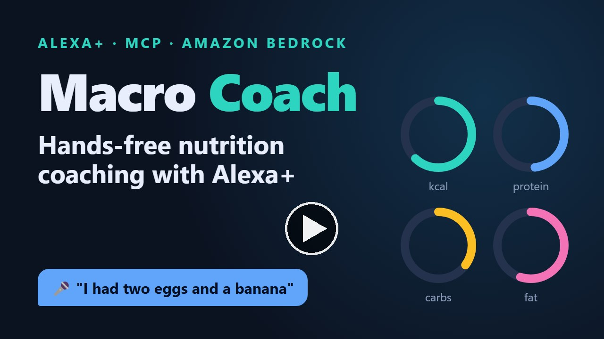
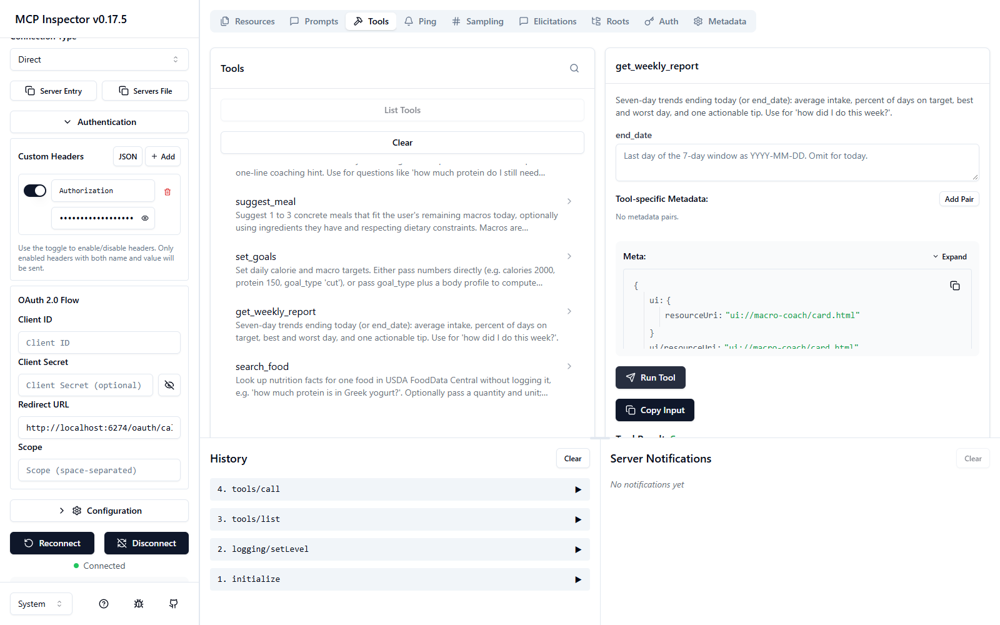
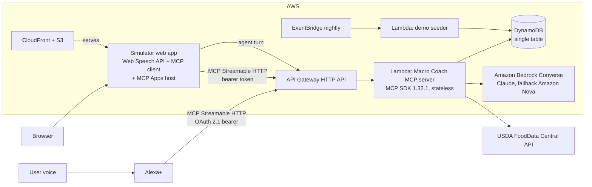

# Macro Coach

[](docs/media/macro-coach-demo.mp4)

▶️ **[Watch the demo video (1:44, with voiceover)](docs/media/macro-coach-demo.mp4)**

A voice-first nutrition coach for Alexa+. Tell it what you ate; Macro Coach logs it, computes calories and macros from USDA FoodData Central, tracks you against your daily targets and suggests what to eat next. Under the hood it is a self-hosted MCP server (spec **2025-11-25**, Streamable HTTP) on AWS.

> This project is new and was built during the Build, Ship, Shape: Amazon Developer Hackathon submission window (October 2026).
>
> **Track:** Alexa+ · **Mini challenge:** AWS Builder

## Try it now (judges)

| What | Value |
|---|---|
| Simulated Alexa+ experience (voice or text) | **https://d27lym254gcbg5.cloudfront.net** |
| MCP endpoint (Streamable HTTP, stateless) | `https://igg6lly82j.execute-api.us-east-1.amazonaws.com/mcp` |
| Test credential | Header `Authorization: Bearer demo-judge-token` |
| Health check | https://igg6lly82j.execute-api.us-east-1.amazonaws.com/health |
| OAuth 2.1 metadata (Alexa+ account linking) | https://igg6lly82j.execute-api.us-east-1.amazonaws.com/.well-known/oauth-protected-resource |

Everything is free to use and stays online through the judging period (November 20, 2026). The demo account has a week of history that is re-seeded every night, so the weekly report always has data.

Say or type these in the simulator, in order:

1. "I had two scrambled eggs and a banana for breakfast."
2. "How much protein do I still need today?"
3. "Actually make that one egg, not two."
4. "What should I eat for dinner? I have chicken, rice and broccoli."
5. "How did I do this week?"
6. "I'm trying to cut. Set my goal to 2,000 calories and 150 grams of protein."

The right-hand panel shows every MCP tool call live (name, arguments, text and structured results), and visual results appear as MCP Apps cards under the reply.

To use your own MCP client (for example MCP Inspector): choose transport **Streamable HTTP**, paste the MCP endpoint and add the header above.



## 30-second pitch

Tracking food is the most effective habit for body-composition goals, and the most abandoned, because typing every meal into an app is tedious. Macro Coach removes the typing. You say "I had two scrambled eggs and a banana for breakfast" and it's logged with real USDA numbers. Ask "how much protein do I still need?" or "what should I eat for dinner? I have chicken, rice and broccoli" and you get a short, spoken answer grounded in data. It never invents numbers; when a portion is unclear, it asks.

## Alexa+ integration status

- **Built to the Alexa+ MCP Toolkit's published requirements:** Streamable HTTP; OAuth 2.1 authorization code flow with PKCE (S256), refresh tokens and client credentials; RFC 9728 protected resource metadata and `/.well-known/oauth-authorization-server`; 401 responses without `WWW-Authenticate`; MCP Apps for visuals; short speakable replies.
- **Real-device onboarding is blocked:** the Alexa AI CLI (`@alexa-ai/cli`) is distributed from a private registry, and access requires an AWS account shared with an Alexa Solutions Architect ("select partners only"). We could not get access within the hackathon window. Details are in [docs/friction-log.md](docs/friction-log.md#1-alexa-mcp-toolkit-connect-the-deployed-mcp-server-to-alexa).
- **So the primary demo is the simulated Alexa+ experience,** as the hackathon rules allow. It talks to the same deployed MCP server as a real MCP client over Streamable HTTP.

To onboard once access is available: set `OAUTH_SIGNING_SECRET`, `OAUTH_CLIENT_ID` and `OAUTH_CLIENT_SECRET` in `server/.env`, deploy, then run `alexa-ai new mcp --mcp-server-url <McpUrl>` and `alexa-ai deploy`. Privacy and terms pages are at `/privacy.html` and `/terms.html` on the simulator domain.

## Features

- **Natural-language logging:** "two scrambled eggs and a banana", "half a cup of oatmeal", "150 g chicken". Amazon Bedrock parses items, quantities and units; FoodData Central supplies the numbers.
- **Corrections:** "make that one egg" or "remove the banana" edits the latest matching entry.
- **Daily budget and coaching hints,** weekly reports with adherence, best and worst days, and one actionable tip.
- **Meal ideas from what you have,** with portions in grams and macros computed from FDC (the model never states nutrition numbers).
- **Goals** set directly or computed with Mifflin-St Jeor for cut, maintain or bulk, in metric or imperial units.
- **Asks instead of guessing** when a portion or food is ambiguous.
- **MCP Apps card** (`ui://macro-coach/card.html`): macro rings, a 7-day chart and a meal idea carousel.

## Architecture



## MCP surface

| Tool | What it does |
|---|---|
| `log_meal` | Parses a free-text meal, resolves each item against FDC, stores entries, returns macros and the remaining budget. Asks a question instead of guessing when a portion is ambiguous. |
| `edit_log_entry` | "Make that one egg, not two" or "remove the banana". Defaults to the latest matching entry. |
| `get_daily_summary` | Calories, protein, carbs, fat and fiber versus targets for a day. |
| `get_remaining_budget` | What's left today, plus a one-line coaching hint. |
| `suggest_meal` | 1 to 3 meal ideas from remaining macros, available ingredients and constraints; macros computed from FDC. |
| `set_goals` | Direct targets, or computed from a profile with Mifflin-St Jeor for cut, maintain or bulk. |
| `get_weekly_report` | 7-day averages, adherence, best and worst day, one tip. |
| `search_food` | Nutrition facts for one food without logging it. |

Also:

- resource `macro-coach://today` (today's summary as JSON)
- prompt `daily_checkin`
- MCP Apps view `ui://macro-coach/card.html` (`text/html;profile=mcp-app`), linked from `log_meal`, `get_daily_summary`, `suggest_meal` and `get_weekly_report` through `_meta.ui.resourceUri`

Every tool has a strict JSON Schema input (`additionalProperties: false`) and returns `structuredContent` plus a one- or two-sentence speakable text. Errors come back as speakable messages, never stack traces.

## Tech

- **MCP:** `@modelcontextprotocol/sdk` **1.32.1** (`LATEST_PROTOCOL_VERSION` = `2025-11-25`; asserted in the integration test). Streamable HTTP in stateless mode with JSON responses.
- **Amazon Bedrock** (Converse API via `@aws-sdk/client-bedrock-runtime`): meal parsing, meal ideas and the simulator's agent loop. An ordered model chain (`BEDROCK_MODEL_IDS`, default `us.anthropic.claude-sonnet-4-6,us.amazon.nova-pro-v1:0`) uses the first model the account can call, with a deterministic rule-based fallback.
- **AWS:** Lambda + API Gateway HTTP API, DynamoDB single table, EventBridge, S3 + CloudFront, all in AWS CDK.
- **Data:** USDA FoodData Central with a ranking layer, curated IDs for common foods and a 24-hour cache.
- **Code:** TypeScript (strict), Node 20+, pnpm workspaces, Express 5, zod 4, React 18 + Vite, vitest, GitHub Actions CI.

## Repository layout

```
/server      MCP server, OAuth, Bedrock/FDC/DynamoDB adapters, tests
/simulator   Simulated Alexa+ experience (Vite + React)
/infra       AWS CDK app
/docs        plan, friction log, product feedback, feature requests, Devpost text, demo script
```

## Local setup

Requirements: Node 20+ and pnpm 10.

```bash
pnpm install
cp server/.env.example server/.env   # optional: add FDC_API_KEY and AWS settings
pnpm dev                             # MCP server on http://127.0.0.1:3000/mcp
pnpm --filter @macro-coach/simulator dev   # simulator on http://localhost:5173
```

Without any keys the server runs fully offline: in-memory store, a small fixture food table with USDA SR Legacy values, and the rule-based parser. A demo user is seeded with token `demo-judge-token` and six days of history.

```bash
curl -s http://127.0.0.1:3000/health
```

## Tests

```bash
pnpm test        # unit tests, MCP integration test, OAuth flow test
pnpm lint
pnpm typecheck
```

The integration test starts the HTTP server on a random port, connects with the SDK's `StreamableHTTPClientTransport`, and calls every tool, the resource, the prompt and the MCP Apps view. The OAuth test runs the full code + PKCE flow and then calls a tool with the issued token. CI runs all three commands on every push.

## Deploy

Requirements: an AWS account with credentials configured (`aws configure`), Amazon Bedrock model access, and a FoodData Central API key (free at https://fdc.nal.usda.gov/api-key-signup).

```bash
cp server/.env.example server/.env   # set FDC_API_KEY; optionally BEDROCK_MODEL_IDS, DEMO_TOKEN, OAUTH_*
pnpm install
pnpm run deploy                      # builds the simulator, bootstraps CDK and deploys everything
```

The stack outputs the MCP URL, health URL and simulator URL. It creates a DynamoDB table, two Lambda functions (MCP server and seeder), an API Gateway HTTP API, an S3 bucket with a CloudFront distribution, and an EventBridge rule that re-seeds the demo user nightly. Remove it with `pnpm --filter @macro-coach/infra destroy`.

### Hosting choice

The MCP server runs on AWS Lambda behind an API Gateway HTTP API. The Streamable HTTP transport runs statelessly with JSON responses (`sessionIdGenerator: undefined`, `enableJsonResponse: true`): every POST builds a fresh `McpServer` and returns a single JSON-RPC response, which the spec allows. That means no Lambda response streaming and no sticky sessions, so it is reliable, scales to zero and stays free for judges. `GET /mcp` returns 405 because there is no standalone server-to-client stream. OAuth codes and tokens are HMAC-signed, so any Lambda instance can verify them without shared session storage.

### Deviations from the original plan

- **Alexa+ device testing** is blocked by MCP Toolkit access (see above); the simulator is the primary demo.
- **Bedrock model:** Claude is first in the chain, but this account is waiting on Anthropic's use case form, so the live deployment currently answers with Amazon Nova Pro. Claude takes over automatically once access is approved.
- **401 without `WWW-Authenticate`:** the Alexa+ MCP Toolkit requires it, although the MCP authorization spec recommends the header. Clients discover auth through `/.well-known/oauth-protected-resource`.
- **`pnpm deploy`** is a built-in pnpm command, so the deploy script is `pnpm run deploy`.
- **Simulator agent loop:** the browser is the MCP client; only the Bedrock call goes through an authenticated server endpoint (`POST /agent/converse`), so no AWS credentials reach the browser. If Bedrock is unavailable for a turn, a local intent router picks the tool for that turn.
- **Secrets** (FDC key, OAuth secrets) are passed to Lambda as environment variables at deploy time and never committed.

## Docs

- [Friction log](docs/friction-log.md): 19 entries with steps, expected vs actual, severity, workaround and suggestion
- [Product feedback](docs/product-feedback.md) for every tool, API and SDK used, including the AWS services
- [Feature requests](docs/feature-requests.md) with priorities
- [Devpost description](docs/devpost-description.md) and [demo video script](docs/demo-script.md)
- [Build plan](docs/plan.md)

## License

MIT, see [LICENSE](LICENSE). Nutrition data from USDA FoodData Central (public domain). No third-party logos, trademarks or music are used in the UI or assets.
